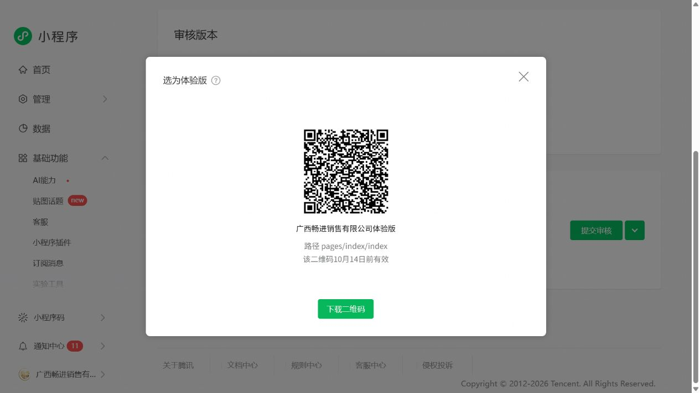

# 微信体验版设置成功 · 2026-10-07

## 账号与版本核对

使用公众平台已存在的登录状态打开小程序首页，显示名称“广西畅进销售有限公司”。首页服务市场链接携带 AppID `wx7e0ac06d1c28077a`，与项目配置一致。首页同时显示备案、微信认证已完成；此为平台页面状态，不替代正式业务资质审核。

在“版本管理”实际看到：

- 开发版本：`1.0.20261007.1`。
- 提交时间：2026-10-07 00:10:51。
- 备注：体验版：线上服务、微信登录、实物奖品门店核销。
- 线上版本：尚未提交。
- 审核版本：暂无。

因此此前“CLI 成功但公众平台未见版本”的待核对项现已解决；没有据此推断早先不可见的原因。

## 实际操作

从该开发版本的更多菜单选择“选为体验版本”，填写 `pages/index/index`，点击提交。平台随后显示“选为体验版”二维码窗口，名称为“广西畅进销售有限公司体验版”，路径正确，提示二维码 **10 月 14 日前有效**。

管理员、开发者及已配置的体验成员可使用上图二维码扫码。若无体验权限，应由管理员在“成员管理”添加指定体验成员；本次未替用户新增人员权限。过期后从同一版本管理页重新打开体验版二维码。

“下载二维码”按钮和图片下载接口均未返回本机下载文件，因此保留实际页面截图作为本次二维码交付，不宣称取得独立原始 PNG。

## 尚待验证

- 微信真机打开、登录、图片加载、抽奖及核销流程。
- 微信资金、企业微信、视频号和小店的真实授权与回执。
- 提交审核、正式发布及正式码切换。

本次只配置体验版本，没有点击“提交审核”，没有改为正式发布状态。后台保持 trial / check_path=false 的体验码设置。
